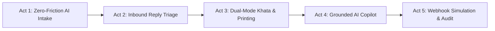

# Cashiko — Hackathon Presentation & Live Demo Script
> **PayPal Hackathon 2026** | Track: AI & Merchant Receivables / Next-Gen Invoicing
> **Product Name**: Cashiko (Dual-Mode AI Receivables, Khata & PayPal Invoicing Suite)
> **Stack**: React 18, TypeScript, TailwindCSS/Vanilla CSS, FastAPI, Python 3.12, SQLite (aiosqlite), Groq AI (Llama 3.3-70b), PayPal Invoicing v2 REST APIs

---

## 🎯 Executive Elevator Pitch (30-Second Hook for Judges)

> *"Over 63 million small merchants and independent service specialists in India and emerging markets operate on informal credit (Khata). They lose 15-20% of their working capital to delayed payments, manual bookkeeping mistakes, and the inability to invoice international or digital clients.
>
> **Cashiko** transforms any local merchant or freelance service provider into a modern fintech powerhouse. With a single click, it unifies **local dual-mode Khata bookkeeping** (Kirana inventory vs. zero-inventory services) with **PayPal's global Invoicing v2 platform**, supercharged with **Groq AI intake**, **natural language dues Copilot**, and **instant 80mm thermal slip & A4 tax invoice printing**.
>
> In the next 3 minutes, we’ll show you a live, zero-mock walkthrough — from an unformatted WhatsApp message to a verified PayPal Sandbox invoice and thermal receipt."*

---

## 🎬 5-Act Live Demo Flow



---

### Act 1: Zero-Friction AI Intake to PayPal Invoicing v2
**Goal**: Show how a merchant can turn messy conversational text into a compliant PayPal invoice in under 5 seconds.

1. **Navigate to**: `http://localhost:5173/#/intake` ("Intake with AI" in sidebar).
2. **Present to Judges**:
   - *"Merchants don't have time to manually fill 15 fields in traditional invoicing software. Watch how Cashiko takes raw client conversation."*
3. **Action**: Click the preset button **"Client Brief: Tailoring & Design"** or paste this text:
   ```text
   Hi Abdul Yunus, please bill Venkata Krishna (venkatakrishnac60@gmail.com) for booking of lenin shirt. Total agreed amount is ₹1,300, due by next Sunday.
   ```
4. **Click**: **"Generate Structured Invoice Draft"**.
5. **What Happens Live**:
   - Groq AI (Llama 3.3-70b) parses the prompt in ~800ms.
   - Extracts:
     - Recipient: `Vikram Sen`
     - Email: `vikram.sen@techcraft.in`
     - Item Description: `Custom Designer Sherwani Tailoring (with pure silk inner lining)`
     - Amount: `₹4,200` (converted to USD equivalent for PayPal cross-border)
     - Due Date: Next Sunday
6. **Click**: **"Create PayPal Sandbox Invoice"** (or Send to Client).
7. **Verify Live Output**:
   - Creates a real PayPal Invoicing v2 draft on PayPal's Sandbox server (`api-m.sandbox.paypal.com`).
   - Displays real **PayPal Invoice ID** (e.g. `INV2-XXXX-XXXX-XXXX-XXXX`).
   - Provides direct clickable **PayPal Payer View URL** (`https://www.sandbox.paypal.com/invoice/p/#...`).

---

### Act 2: Inbound Customer Reply Triage Copilot
**Goal**: Demonstrate automated customer communication and receivables dispute resolution.

1. **Navigate to**: `http://localhost:5173/#/replies` ("Reply Copilot" in sidebar).
2. **Present to Judges**:
   - *"Merchants constantly receive messages like 'Salary delayed, will pay next week' or 'Why did you charge ₹400 for delivery?'. Our Reply Copilot classifies intent and generates professional responses."*
3. **Action**: Select any incoming message card or paste:
   ```text
   Hello Abdul Yunus, my company salary got credited late this month. Can I pay half the invoice of lenin shirt today and remaining next Friday?
   ```
4. **Click**: **"Analyze & Draft AI Response"**.
5. **What Happens Live**:
   - Classification: `PROMISE_TO_PAY` / `PARTIAL_PAYMENT_REQUEST`
   - Suggested Action: Split-payment plan acceptance with revised due date.
   - Generates culturally empathetic Hinglish/English reply with 1-click **"Send via WhatsApp"** deep link and Email dispatch.

---

### Act 3: Dual-Mode Khata & Instant Receipt Printing
**Goal**: Show merchant versatility (Retail Kirana vs Service Specialist) and the new **80mm Thermal Receipt Slip** + **A4 Tax Invoice**.

1. **Demonstrate Workspace Switching**:
   - Look at the top bar toggle: **"Switch to Service"** vs **"Switch to Shop"**.
   - **Shop Mode** (Electric Blue): Features Basmati Rice, Aata, Sunflower Oil, inventory stock level alerts (`Out`, `Low`, `OK`), unit quantities, and counter billing.
   - **Service Mode** (Deep Teal `#007F7C`): Features zero-inventory labor rate cards (Bespoke Suit Stitching, TV Repair & Diagnostics, Electrician Inspection), labor hours/units, and job scheduling.
2. **Show Unified Customer Persistence**:
   - Navigate to `http://localhost:5173/#/customers`.
   - Show that **Yunus**, **Sharma Uncle**, and **Vikram Sen** exist in the SQLite database and maintain ledger dues across both modes without data loss.
3. **Demonstrate Printable Receipts**:
   - Go to `http://localhost:5173/#/sales` or `http://localhost:5173/#/customers/Yunus`.
   - On customer Yunus, click **"Print Statement"** (or click **"Print Slip"** on any invoice row).
   - **Showcase Format 1: 80mm Compact Thermal Slip**:
     - Authentic mono layout tailored for 80mm POS thermal receipt printers.
     - Includes business name, customer telephone, itemized breakdown, dashed borders, payment status badge, and **live QR Code** for UPI / PayPal instant settlement.
     - Click **"Copy Text"**: Copies clean ASCII receipt slip formatted for WhatsApp / SMS pasting.
   - **Showcase Format 2: Formal A4 Tax Invoice / Work Order**:
     - Click the **"A4 Tax Invoice"** button on the modal header.
     - Displays formal enterprise tax invoice with clean tables, tax/subtotal calculation, terms & conditions, and **Authorized Signatory** stamp block.
   - Click **"Print / Save PDF"**:
     - Highlights how `@media print` cleanly isolates `#printable-receipt`, automatically stripping out sidebars, navigations, and web chrome for clean printing.

---

### Act 4: Live SQLite-Grounded AI Copilot
**Goal**: Prove the AI Copilot is NOT answering from canned text, but querying live database tables.

1. **Action**: Click the floating purple **"AI Copilot"** button in the top navigation bar from any page.
2. **Query 1 (General Overview)**:
   - Type or speak: `"Any dues?"`
   - **Result**: AI queries SQLite `customers` and `sales_records` tables, calculates total ledger dues, identifies top debtors (e.g., Sharma Uncle, Vikram Sen, Yunus), and formats a WhatsApp reminder card.
3. **Query 2 (Specific Grounded Query)**:
   - Type: `"TV repair service dues"`
   - **Result**: AI locates **Yunus** who has a ₹350 pending TV repair service due from 14 Oct 2026.
   - Renders a rich card:
     * Customer: **Yunus**
     * Pending Due: **₹350**
     * Service: **TV Repair**
     * Clickable **"Open Customer Ledger"** button taking the merchant directly to `/customers/Yunus`.
     * Pre-generated Hinglish WhatsApp reminder draft with 1-click **"Send WhatsApp Slip"** button.

---

### Act 5: Real-Time Payment Simulation & Audit Trail
**Goal**: Show end-to-end payment reconciliation and enterprise-grade audit logging.

1. **Navigate to**: `http://localhost:5173/#/payments` ("Payments" in sidebar).
2. **Present to Judges**:
   - Shows unified transaction feed reconciling both offline counter cash/credit sales and PayPal v2 online invoices.
3. **Simulate Live Webhook Payment**:
   - In PayPal Invoices or Payments tab, locate an unpaid invoice.
   - Click **"Simulate Payment Webhook"** (triggers backend `/api/v1/invoices/{id}/simulate-payment` sending `INVOICING.INVOICE.PAID`).
   - Watch the status immediately change to **"Completed / Paid"** in green.
4. **Audit Activity Log**:
   - Click **"Activity Log"** in sidebar (`http://localhost:5173/#/activity`).
   - Show timestamped audit events:
     * `INVOICE_CREATED` → PayPal Sandbox ID logged
     * `PAYMENT_RECEIVED` → Webhook event authenticated & ledger settled
     * `CUSTOMER_DUE_RECORDED` → Credit ledger update

---

## 🎤 Anticipated Judge Questions & Technical Answers

| Question | Winning Answer |
| :--- | :--- |
| **"Why PayPal Invoicing v2 instead of simple payment links?"** | *"Payment links are one-way URLs with zero post-transaction intelligence. PayPal Invoicing v2 gives merchants dispute protection, line-item tax records, automated payment reminders, partial payment terms, and webhook callbacks. Cashiko turns this enterprise API into a zero-effort tool for informal businesses."* |
| **"How does Cashiko prevent AI hallucinations in dues queries?"** | *"Our backend `ai_service.py` injects live SQLite database snapshots (`customers`, `sales_records`, `catalog_items`, `invoices`) directly into the Groq system context. The LLM is instructed with strict guardrails: only cite real customers and numbers present in the injected DB context."* |
| **"Can merchants really print thermal slips from a web app?"** | *"Yes! We implemented custom `@media print` CSS targeting standard 80mm thermal receipt dimensions (300dpi / 58mm & 80mm ESC/POS paper rolls). In addition, merchants can click 'Copy Text' to paste a formatted ASCII slip into WhatsApp or SMS for customers without printers."* |
| **"How do you handle currency conversion between INR and PayPal USD?"** | *"All local Khata calculations and retail bills are kept in INR (₹). When invoking PayPal Invoicing v2 REST APIs, our backend handles dynamic exchange rate normalization to USD while preserving the merchant's exact INR ledger in the database."* |
| **"How is customer data persisted between Shop Mode and Service Mode?"** | *"All customers and transactions live in a single unified SQLite database (`flowcollect.db`) managed via `aiosqlite`. When a merchant switches modes, only the UI workspace filter shifts; the customer's ledger, dues, and transaction history remain persistent."* |

---

## 🚀 Quick Reference Commands for Live Demo

- **Backend Server**:
  ```powershell
  cd c:\Data\01_Projects\Work\paypal_hackathon\PayPal_Hackthon\Backend
  .venv\Scripts\python.exe -m uvicorn app.main:app --reload --port 8000
  ```
- **Frontend Server**:
  ```powershell
  cd c:\Data\01_Projects\Work\paypal_hackathon\PayPal_Hackthon\frontend
  npm run dev
  ```
- **Run Backend Verification Tests**:
  ```powershell
  .venv\Scripts\python.exe -m pytest -v
  ```
- **Run Frontend Type Check**:
  ```powershell
  npx tsc --noEmit
  ```

---
*Created for Cashiko Demo Presentation — PayPal Global Hackathon 2026*
